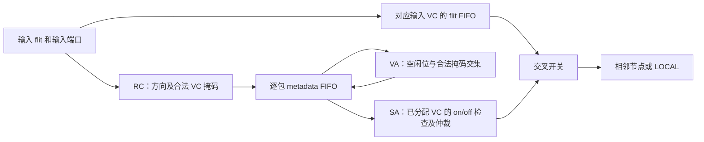

# Torus 首版实现方案详解（2026-11-02）

> 2026-11-04更新：四类单VC规则为首版历史方案；当前已改为输入端口区分维度、前后阶段多副本。最新实现与数据见[阶段VC验证报告](phase_vc_verification_20261104.md)。

<!-- Modify by Michael Tan，20261104: distinguish historical global classes from the current phase-pool implementation. -->

<!-- Modify by Michael Tan，20261102: explain implemented Torus topology, routing, dateline VC and packet lifecycle from actual RTL. -->

本说明对应实现提交 `6d778da`，描述本次已经写入 RTL 并完成首轮功能仿真的方案。后续文档提交不代表新增 RTL 功能。测试命令、各次日志与结果见 [验证报告](torus_verification_20261102.md)，变更过程见 [修改记录](修改记录.md)。

## 1. 本版方案与设计范围

本版采用**双向二维 Torus、确定性最短路径 X 后 Y 路由，以及 dateline 四类 VC 分配**。每个路由器保留 LOCAL、NORTH、SOUTH、WEST、EAST 五个端口；沿用原 Mesh 的输入缓冲、交叉开关和仲裁结构。新增首尾回接，同时把环绕路径的 VC 资格落实到逐包 metadata 和实际分配器中。

本版在 `torus/` 独立实现。根目录 `src/` 不修改；板级顶层仍未切换为 Torus。本版没有拥塞自适应选路、随机等距选路、逃逸路由切换或源路由字段。流量遇到拥塞时等待既定路径上的合法资源，不临时改走较长路径。

| 项目 | 已实现的配置或行为 | 核查位置 |
| --- | --- | --- |
| 网络顶层 | `torus`，默认 5×5 | [torus.sv](../src/torus.sv) |
| 尺寸参数 | `MESH_SIZE_X/Y`，名称沿用原接口；内部按实际实例尺寸路由 | `torus → router → input_block → input_port → rc_unit` |
| 坐标方向 | EAST 增大 X，WEST 减小 X；SOUTH 增大 Y，NORTH 减小 Y | RC 和链路 generate |
| 支持尺寸 | 当前坐标宽度下每维 2..8；两维独立设置 | 顶层 `initial` 检查 |
| 物理端口 | 五端口，枚举值 LOCAL=0、NORTH=1、SOUTH=2、WEST=3、EAST=4 | [noc.sv](../src/noc.sv) |
| VC 数量 | 每个输入端口 4 个 VC；Torus 要求 `VC_NUM==4` | `noc_params` 和顶层检查 |
| 缓冲 | 默认每个输入 VC 为 8 个 flit 槽、8 个 metadata 槽 | [input_buffer](../src/input_buffer_src_circular_full.sv) |
| flit 类型 | HEAD、BODY、TAIL、HEADTAIL | `noc_params` |
| 转发单元 | 包头确定路由及资源资格，包内所有 flit 沿该跳已分配路径转发 | input buffer、VA、SA |

这里的 2..8 范围来自当前 `noc_params` 中 X/Y 各 3 位的坐标编码，不能据此认为任意更大尺寸已经支持。顶层对尺寸小于 2、超过坐标范围或 VC 数不为 4 的实例调用 `$fatal`。这是仿真配置检查，不是运行时硬件错误接口。缓冲深度首轮实际使用 8，其他深度未在本次验证中验收。

## 2. 拓扑与链路连接

### 2.1 邻居关系与端口方向

令实际尺寸为 NX×NY，坐标为 `(x,y)`。四个网络邻居为：

| 当前路由器的输出方向 | 下一个节点 | 下游接收端口 |
| --- | --- | --- |
| EAST | `((x+1) mod NX, y)` | WEST |
| WEST | `((x+NX-1) mod NX, y)` | EAST |
| SOUTH | `(x, (y+1) mod NY)` | NORTH |
| NORTH | `(x, (y+NY-1) mod NY)` | SOUTH |

因此，RC 中的 `INPUT_PORT` 表示**当前节点从哪个端口收到 flit**，与上一跳的发送方向相反。例如 WEST 转发到的下游节点从 EAST 端口接收；判断 X/Y 维度时两个方向都属于同一维度。

外部 LOCAL 数组按 `[x][y]` 组织，内部实例名仍保留 `mesh_row[y].mesh_col[x]`。名称中包含 `mesh` 只是复用原层次名称，不意味着这些实例没有环绕连接。

### 2.2 内部连接与边界回接

`torus.sv` 保留原 Mesh 的内部邻接 generate，再增加两组边界 generate：

- `horizontal_seam[row]`：连接 `(NX-1,y)` 的 EAST 与 `(0,y)` 的 WEST，覆盖双向传输。
- `vertical_seam[col]`：连接 `(x,NY-1)` 的 SOUTH 与 `(x,0)` 的 NORTH，覆盖双向传输。

每个单向 `router_link` 都同时连接 flit、valid 和反向的 on/off、VC 释放通知。每条双向邻接由两个单向 `router_link` 实例构成，不能只补数据线而遗漏反向流控。

`router_link` 的实际赋值是 `router_if_up.data = router_if_down.data`，valid 同方向，流控反方向。因此实例参数名不能直接解释为发送端/接收端；新增回接按该实际赋值方向与原内部连接逐一对应。

5×5 的 Mesh 有 40 条双向邻接链路；Torus 有 50 条，增加 10 条双向链路，等价于增加 20 条单向数据链路。一般 NX×NY Torus 按端口链路计有 `2×NX×NY` 条双向链路。LOCAL 接口不计入该数量。

维度为 2 时，同一节点的正、负方向虽然通向同一个坐标，仍保留独立端口和独立链路，属于平行连接，不能把两者接到同一接口上造成重复驱动。首版确定性等距规则会优先使用 EAST/SOUTH，但硬件端口仍完整连接。

### 2.3 时钟与链路延迟

沿用单一 `clk/rst`。`router_link`、`node_link` 和交叉开关是现有组合连接，本次没有为环绕链路新增流水寄存器、跨时钟处理或物理长线延迟模型。仿真中的跳数和可达性结果不能直接解释为 FPGA 布局布线后的时钟频率或链路时序结论。

## 3. 最短路径 XY 路由

### 3.1 方向选择

路由单元是 [rc_unit_Xiugai2.sv](../src/rc_unit_Xiugai2.sv) 中的 `rc_unit`。只对 HEAD/HEADTAIL 进行路径和类别计算：

```text
当 dst_x != x：
    dE = (dst_x - x + NX) mod NX
    dW = (x - dst_x + NX) mod NX
    dE <= dW 时选 EAST，否则 WEST
否则当 dst_y != y：
    dS = (dst_y - y + NY) mod NY
    dN = (y - dst_y + NY) mod NY
    dS <= dN 时选 SOUTH，否则 NORTH
否则：
    LOCAL 弹出
```

RTL 使用 `int` 扩展后的加减和一次条件减法实现取模：合法坐标下中间值在 1 到 `2N-1` 范围内，无需通用除法/余数运算。实际环长来自顶层传下来的 `NETWORK_SIZE_X/Y`，不直接用包中默认 5×5 代替实例尺寸。

X 坐标未匹配前不进入 Y；到达目标 X 后只走 Y，禁止 Y→X。偶数尺寸下的等距固定选正方向，避免不同节点采用不一致选择。确定性最短路径不会因为 VC 忙而改变方向。

### 3.2 跳数与示例

两节点的最短网络跳数为：

```text
H = min(abs(dst_x-src_x), NX-abs(dst_x-src_x))
  + min(abs(dst_y-src_y), NY-abs(dst_y-src_y))
```

LOCAL 注入和弹出不计为网络跳。5×5 Torus 最大最短网络跳数为 4；原 5×5 Mesh 为 8。这是拓扑距离的比较，不能预先承诺实际平均延迟或吞吐提升。

| 尺寸与源目的 | 本版实际路径 | 说明 |
| --- | --- | --- |
| 5×5，`(0,0) → (4,0)` | WEST 到 `(4,0)`，再 LOCAL | X 负向跨界，一跳 |
| 5×5，`(4,0) → (0,0)` | EAST 到 `(0,0)`，再 LOCAL | X 正向跨界，一跳 |
| 5×5，`(0,0) → (4,4)` | WEST 到 `(4,0)`，NORTH 到 `(4,4)` | X 后 Y，两次跨界 |
| 5×5，`(1,1) → (3,4)` | EAST 到 `(2,1)`、`(3,1)`，NORTH 到 `(3,0)`、`(3,4)` | 两个维度均取最短，两维共四跳 |
| 4×4，`(0,0) → (2,2)` | EAST、EAST、SOUTH、SOUTH | 两维等距都固定选正方向 |
| 任意尺寸，同节点发送 | 当前路由器直接 LOCAL | 零网络跳，仍经过缓冲/VA/SA |

## 4. Dateline 与 VC 状态

### 4.1 为什么增加环绕后还要约束 VC

普通 XY 只消除了 Y→X 转向依赖。Torus 在每一维内部仍形成环，因此仅补齐首尾连线、继续让 VA 任意选 4 个 VC，不能消除环内资源循环等待。

本版把坐标首尾之间的链路作为 dateline：EAST 的 `NX-1→0`、WEST 的 `0→NX-1`，以及 SOUTH 的 `NY-1→0`、NORTH 的 `0→NY-1`。跨界这一次传输就使用后类 VC；同维后续转发保持后类，不退回前类。X→Y 时按 Y 维度重新初始化类别。

### 4.2 类别、掩码和资源含义

| 下游 VC 编号 | 常量 | 含义 | `allowed_vcs[3:0]` |
| --- | --- | --- | --- |
| 0 | `VC_X_BEFORE` | X 维 dateline 前 | `0001` |
| 1 | `VC_X_AFTER` | X 维 dateline 后，含跨界跳本身 | `0010` |
| 2 | `VC_Y_BEFORE` | Y 维 dateline 前 | `0100` |
| 3 | `VC_Y_AFTER` | Y 维 dateline 后，含跨界跳本身 | `1000` |
| 任意一个本地接收 VC | 无网络类别要求 | LOCAL 弹出终点 | `1111` |
| 无合法选择 | — | 拒绝非法包头，或无包时不提出请求 | `0000` |

这四个类别对应**每个输入端口内的四个独立 VC 缓冲**。VC1 不是整个网络共享的一个资源；完整资源标识还包括目标节点和接收端口。一个网络方向本版只允许一个类别对应的 VC，另三个空闲也不能替代它。该取舍限制资源池灵活性，性能效果需后续实测。

### 4.3 转换规则与输入约束

| 输入端口及类别 | 输出方向 | 下一跳类别 |
| --- | --- | --- |
| LOCAL，源任意 VC | X | 当前跳跨界则 VC1，否则 VC0 |
| LOCAL，源任意 VC | Y | 当前跳跨界则 VC3，否则 VC2 |
| EAST/WEST 输入 VC0/1 | X | 输入 VC1 或当前跳跨界时 VC1，否则 VC0 |
| EAST/WEST 输入 VC0/1 | Y | 当前跳跨界时 VC3，否则 VC2 |
| NORTH/SOUTH 输入 VC2/3 | Y | 输入 VC3 或当前跳跨界时 VC3，否则 VC2 |
| NORTH/SOUTH 输入 | X | 拒绝 Y→X |
| EAST/WEST 输入 VC2/3 | 网络方向 | 拒绝输入类别维度不匹配 |
| NORTH/SOUTH 输入 VC0/1 | Y | 拒绝输入类别维度不匹配 |
| 目的等于当前坐标 | LOCAL | `1111`，作为终端处理 |

LOCAL 注入 VC 只用于选择源端输入缓冲，不携带网络阶段状态；类别从第一次网络输出重新确定。LOCAL 弹出是 RC 中的终端分支，当前 RTL 不在该分支额外检查来向类别维度；不能将它描述成所有非法来向组合均被诊断。

X→Y 后不存在回 X 的合法转发；不过 VC1→VC2 是允许的维度切换，不能把“VC 数字不减少”当作本版的规则。例如 LOCAL 注入可由源 VC3 转为网络 VC0，LOCAL 弹出也可以选 VC0；真正约束的是**同维不从后类退回前类，以及维度不从 Y 退回 X**。

### 4.4 逐跳实例：跨界后保持和跨维初始化

5×5，`(4,2) → (1,2)`：

| 跳 | 当前节点及输入 | 输出到 | 下游接收 VC | 原因 |
| --- | --- | --- | --- | --- |
| 1 | `(4,2)`，LOCAL 任意 VC | EAST 到 `(0,2)` | VC1 | 该跳跨 dateline |
| 2 | `(0,2)`，WEST 输入 VC1 | EAST 到 `(1,2)` | VC1 | 虽然不跨界，必须保持 X 后类 |
| 弹出 | `(1,2)`，WEST 输入 VC1 | LOCAL | 本地可分配 VC | 到达目的，不再申请网络资源 |

5×5，`(0,0) → (4,1)`：

| 跳 | 当前节点及输入 | 输出到 | 下游接收 VC | 原因 |
| --- | --- | --- | --- | --- |
| 1 | `(0,0)`，LOCAL 任意 VC | WEST 到 `(4,0)` | VC1 | X 负向跨界 |
| 2 | `(4,0)`，EAST 输入 VC1 | SOUTH 到 `(4,1)` | VC2 | 转 Y，且本跳不跨 Y dateline |
| 弹出 | `(4,1)`，NORTH 输入 VC2 | LOCAL | 本地可分配 VC | 到达目的 |

因此，X 的“已跨界”不会直接传成 Y 的“已跨界”。实际传递方式是修改发送 flit 的 `vc_id`，下游按输入端口和收到的 VC 编号恢复维度阶段，没有增加 flit 状态位。

## 5. 数据格式与模块数据通路

当前 `noc_params` 的 HEAD 负载为 16 位，X/Y 目的坐标各 3 位，因此 data 为 22 位；线上 flit 加 2 位 label 和 2 位 `vc_id`，共 26 位。输入 flit FIFO 使用不含 VC 的 `flit_novc_t`，共 24 位；下游 VC 从 metadata 重新拼回发送 flit。BODY/TAIL 的 22 位为普通负载，不按目的地址重新解析。



| 模块 | 本次承担的变化 |
| --- | --- |
| [torus.sv](../src/torus.sv) | 建立环绕拓扑、检查几何配置，启用 Torus 模式并传实际尺寸 |
| [noc.sv](../src/noc.sv) | 定义四个类别常量，保持 flit 格式 |
| [router.sv](../src/router.sv) | 向输入模块传模式和尺寸，保持接口/交叉开关组织 |
| [input_block](../src/input_block_Xiugai2.sv) | 传端口编号，把逐端口逐 VC 合法掩码接入 VA 接口 |
| [input_port](../src/input_port_Xiugai2.sv) | 计算包头资格、拒绝非法包头，分发到输入 `vc_id` 对应的缓冲 |
| [input_buffer](../src/input_buffer_src_circular_full.sv) | 保存队首包的路由、合法掩码、下游 VC 与分配状态 |
| [input_block2vc_allocator](../src/input_block2vc_allocator.sv) | 增加 `allowed_vcs[输入端口][输入VC]`，每项为 4 位掩码 |
| [vc_allocator](../src/vc_allocator.sv) | 请求与实际选择都按掩码过滤 |
| [switch_allocator](../src/switch_allocator_Xiugai1.sv) | 复用原逻辑，按已分配的下游 VC 读取 on/off |
| [router_link](../src/router_link.sv)、[node_link](../src/node_link.sv) | 复用原组合链路和 LOCAL 接入 |

## 6. 逐包 metadata 与包生命周期

### 6.1 为什么掩码必须逐包存储

一个输入 VC 可以按顺序缓存多个包。前包可能还在等 VA，当前输入线上已经出现后包的包头或 BODY。如果 VA 直接读当前 RC 输出，会把后包的路由资格用于前包。

本版在原 `packet_meta_t` 中增加 4 位 `allowed_vcs`，与 `out_port` 一起在接受 HEAD/HEADTAIL 时入队。完整 metadata 为：

| 字段 | 当前宽度 | 作用 |
| --- | --- | --- |
| `allowed_vcs` | 4 | 本包下一跳允许的下游 VC 集合 |
| `out_port` | 3 | 本包下一跳输出端口 |
| `downstream_vc` | 2 | VA 成功后得到的下游 VC |
| `vc_allocated` | 1 | 队首包是否已完成 VA |

每条记录共 10 位；相对原 metadata 增加 4 位。默认每个输入 VC 有 8 条记录。该位数只是逻辑字段规模，不是 FPGA 综合资源报告。

只允许 metadata 队首包请求 VA/SA。后包即便已有 flit，也不能越过前包；它的掩码会保留到自己成为队首。BODY/TAIL 不产生新 metadata，也不改变前包锁定的输出端口和下游 VC。

### 6.2 接收、分配、发送和释放

1. 包头通过地址/来向检查，且目标输入 VC 的 flit FIFO 与 metadata 接受条件满足时，写 flit 并压入一条未分配记录。
2. 有队首包且 `vc_allocated=0` 时提出 VA 请求；即使包尚未完整到达，也可提前为队首分配下游 VC。
3. VA 授权后，在该记录保存 `downstream_vc` 并置 `vc_allocated=1`。
4. 队首已分配且 flit FIFO 非空时提出 SA 请求；下游对应 VC 的 on/off 为 1 且仲裁成功，才读取一个 flit 并发送。
5. 同包后续 flit 沿保存的输出端口转发，发送 `vc_id` 始终替换为该跳的 `downstream_vc`。
6. 成功读出 TAIL 或 HEADTAIL 时，弹出 metadata，同时向上游输出本输入 VC 的释放通知；下一条包记录随后成为队首。

接收流通过 `write_packet_open` 维护包边界：HEAD 打开一个多 flit 包，BODY/TAIL 必须属于已打开的包，TAIL 关闭；HEADTAIL 自身完成，不保持打开状态。允许同 VC 连续完整包排队，不允许一个包未收完就插入另一个包头。

HEADTAIL 仍经过包头资格存储、VA 和 SA，不是组合直通旁路。网络可以按 flit 提前推进长包，功能上具有虫洞式逐 flit 转发特征；不要求先把整个包存完才能分配和发送。

### 6.3 时序关系

在无竞争、下游 ready 且缓冲初始空的示意中：

| 上升沿 | 该输入 VC 的动作 |
| --- | --- |
| E0 | 接受 HEAD，写 flit 和 metadata |
| E1 | 捕获基于队首记录产生的 VA 授权 |
| E2 或之后 | SA 授权时发送首个 flit；多 flit 包后续继续等待各自 SA 机会 |
| 发送 TAIL 的边沿 | 释放本输入 VC 的该包 metadata，并寄存向上游的释放脉冲 |
| 后续边沿 | 上游采到释放通知后恢复其对应下游 VC 可用位，再允许新包分配 |

这描述当前寄存/组合关系，不承诺所有包固定三拍完成。拥塞、VC 等待、仲裁及源端 BODY/TAIL 到达时间都会延长驻留。某个路由器发出了 TAIL，并不代表它所占的**下一节点缓冲**已经释放；下一节点仍需等该 TAIL 离开自己的输入缓冲后再通知前一节点。

## 7. VA、SA 和两级流控合同

### 7.1 VA 使用同一掩码过滤请求与选择

对一个输入端口/VC 的队首包：

```text
candidate = is_available_vc[out_port] & queued_allowed_vcs
request   = vc_request & (candidate != 0)
```

请求经原有两级输入优先仲裁：先在每个输入端口的 VC 间轮询，再在每个输出端口的输入竞争者间轮询。实际选 VC 时同样检查 `available & allowed`，选择候选中的最低编号。网络转发掩码为 one-hot 时只有唯一候选；LOCAL 弹出为 `1111` 时才可能在多个本地接收 VC 中选择。

无合法空闲 VC 时保持等待，不能退而分配类别不符的空闲 VC。授权边沿清除对应下游 VC 可用位；只有收到该 VC 的释放通知才恢复。释放通知先更新可用状态，再在后续周期供新请求使用，没有承诺同周期释放旁路授权。

### 7.2 两种反向信号不能混用

| 信号 | 控制粒度 | 发送条件与含义 |
| --- | --- | --- |
| `is_on_off` | 每个 VC 的 flit 容量 | 可用为 1 时允许发送该 VC 的 flit；并不保证可以启动任意新包 |
| `is_allocatable` | 每个 VC 的包级所有权释放 | TAIL/HEADTAIL 从接收输入缓冲读出后通知上游可再次分配该 VC |

VA 的可用位在复位时全部为 1，因此空闲网络启动不需要持续拉高 `is_allocatable`。运行期间该信号应按包释放事件产生。把它恒置 1 会使 VA 提前恢复仍被包占用的 VC，可能产生包交织；本次拥塞调试修正的就是 TB 的此类接收端建模错误。

SA 只在队首包已完成 VA、FIFO 非空且 `on_off[out_port][downstream_vc]` 为 1 时请求发送。停止服务会阻止发送，不丢弃队首包、不更换已保存的 VC。

原 flit FIFO 保留 on/off 迟滞，`ON_OFF_LATENCY=2`。默认深度 8 时，占用上升到 7 触发关闭，下降到 1 或 0 才重新打开。此处保留原逻辑，并不等于新增了精确 credit 计数协议，也没有对新增多拍链路做容量重标定。

### 7.3 LOCAL 接入要求

本地发送端按 `vc_id` 选择源输入 VC，并遵守对应 on/off 和包内顺序；若利用多包排队，必须完整连续发送当前包的 flit，再开始后包。类别由首次 RC 决定，不能要求源注入 VC 必须等于下一跳网络 VC。

本地接收端按每个接收 VC 独立处理包级占用。若像本次 TB 一样无额外排队、每个 valid flit 都立即消费，则消费 TAIL/HEADTAIL 后输出单周期释放通知；若外接真实接收 FIFO，释放时机必须按它的实际资源合同定义，不能在尚有资源依赖时提前宣布可重用。端点最终提供服务是本次无环模型的前提。

## 8. 错误指示、复位与兼容边界

- HEAD/HEADTAIL 的目的坐标超出实际 NX/NY 时，RC 输出 `route_error_o=1`、掩码为零；`input_port` 拒绝写入，并在 valid 期间将对应输入 VC 的 `error_o` 置 1。
- 转发分支检测 Y→X 或输入类别维度不匹配，同样拒绝该包头。LOCAL 弹出分支按前述终端规则处理。
- 输入缓冲还报告写入不被接受、未分配/空 FIFO 读出、空队列或重复 VA 等既有协议错误。错误指示不是包含包 ID 的独立恢复消息队列，也不是完整错误恢复状态机。
- 非法 HEAD 被拒绝后，随后 BODY/TAIL 不会自动被收集、丢弃并重同步；不承诺全网非法包自动恢复。未知态、包中途缺 TAIL、端点无限停顿的全面恢复也未实现。
- 复位清空有效状态、FIFO 指针、metadata 计数和包边界状态，并恢复 VA 初始可用位；不要求把存储数组逐项清零。本次验证的是排空后复位再传输，没有验收带在途包复位的端到端恢复语义。
- 共享路由模块的 `TORUS_MODE` 默认 0，原 `mesh.sv` 因而保持普通 XY 选择；仅 Torus 顶层显式设为 1。共享接口和 metadata 已变，性能对照必须使用修改前的独立 Mesh 编译基线。

## 9. 通道依赖检查与验证证据

依赖检查器 [check_torus_channel_dependencies.py](../scripts/simulation/check_torus_channel_dependencies.py) 枚举合法源目的路径，将网络资源表示为 `(接收节点x, 接收节点y, 接收端口, VC)`，把每条路径上相邻资源之间的等待关系合并成有向图，再用拓扑排序检查环。

同一物理输入 VC 的多包共享同一资源节点，路径依赖取并集；独立 VC 不混为一个共享 FIFO。LOCAL 注入是没有网络入边的起点，LOCAL 弹出是没有后续网络请求的终点。模型用注入 VC0 和一个抽象终端表示这两类端点，不表示实际端点只提供一个 VC。

dateline 的前→后约束切开同维环，X→Y 的单向维度依赖避免跨维回环；有限最短路径也不会在一个方向环上无限绕行。该解释由路径模型检查支持，本次未把它提升为对完整 RTL、仲裁公平性或端点协议的形式化证明。

| 验证层次 | 本次证据 | 覆盖边界 |
| --- | --- | --- |
| 依赖模型 | 每维 2..8，共 49 种尺寸、41,209 条路径无环且跳数最短 | 假定类别/所有权正确，源提供完整包、终端最终服务，无协议反向依赖 |
| RC 单元 | 5×5、4×4、2×3、2×2，共 261,120 次检查 | 全目的编码、输入端口/VC、四种 label 和拒绝条件；不是完整输入端口错误恢复测试 |
| VA/metadata | 非法空闲 VC 不能替代、释放重分配、零掩码、两包不同掩码排队 | 有限定向场景，不是任意竞争/公平性形式化证明 |
| 网络集成 | 四种尺寸分别 950/464/114/68 包完整收发 | 全源目的、单/多 flit、并发、背压、排空后复位 |
| 持续拥塞 | 5×5 总计 625 包、2050 flit、4660 次网络 flit 跳转移 | 600 包持续热点/环绕/置换注入，加复位后的 25 包；非性能扫点 |
| 排空审计 | FIFO、metadata、包打开状态和 VA 可用位恢复空闲 | 证明这些有限测试结束时无资源残留 |

每次成功运行保存 RTL/TB 的 SHA256，并与最终文件核对一致。网络测试不仅统计收包，还核对目的、包 ID、标签/负载顺序、VC 掩码授权、每跳方向、跨界类别、总最短跳数及四方向环绕覆盖。精确日志链接保留在验证报告中，本说明不重复复制每份日志。

## 10. 后续扩展的边界

首版为后续流量回归和性能比较提供功能起点。增加自适应路由、更多 VC、共享缓冲或链路流水后，都需要重新审查类别规则、资源依赖和流控容量，不能直接沿用本版无环结论。Windows 目标综合/实现、板级 ILA 接入及实际时序尚未开展；也尚未证明 Torus 相对 Mesh 的最终性能收益。
